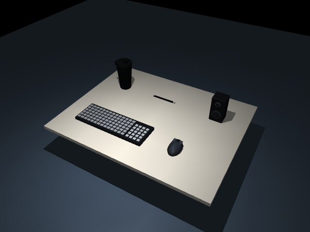
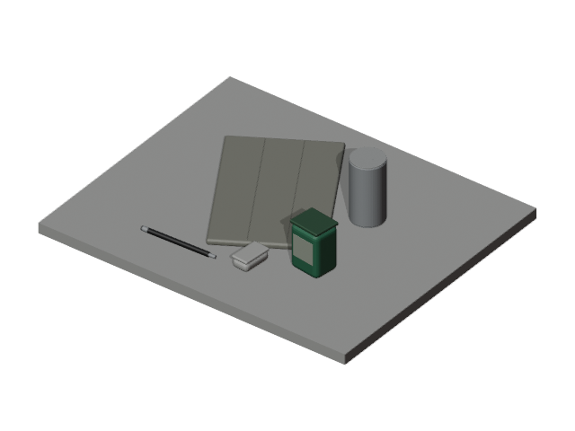
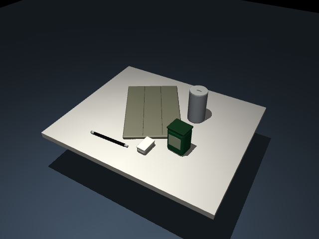

# ORCA Text-to-MuJoCo Environment Agent

## Start by sharing this link with Codex

```text
https://github.com/niujiazhen/orca-agent-taskgen
```

Use a local Codex chat with computer/file access. This repository contains the
agent instructions for checking dependencies, preparing the project, starting
phone upload, modeling in Blender, and generating the MuJoCo scene. The agent
does the setup and command execution; you provide the photo and inspect/save
the Blender models when prompted.

**For Codex and other coding agents:** read [AGENTS.md](AGENTS.md), then follow
[the agent quickstart](docs/CODEX_QUICKSTART.md) and
[the repository skill](.agents/skills/orca-env-generator/SKILL.md). For a user
getting started from this link, carry out authorized setup and present a phone
upload QR code. Follow any explicit review/explanation request instead.
Read the skill from the current checkout to use the v0.4 Blender workflow.

The expected experience is:

```text
Share link -> agent prepares tools -> scan QR and upload photo
           -> inspect/save Blender models -> receive MuJoCo scene and video
```

The default branch includes this workflow. Manual installation instructions
below are also available for users who prefer terminal setup.

This Codex plugin turns text or a tabletop photo into a visualizable MuJoCo
scene. Primitive tasks also support a Gymnasium RL environment for one ORCA
v1 right hand. Version 0.4 adds editable local Blender modeling for photo scenes.

Text input supports gestures, pickup, and placement of boxes, cylinders, and
spheres. Legacy primitive photo tasks also support pens, erasers, and books.
The new Blender path supports up to five common rigid objects for scene display,
including shapes outside those categories. Models approximate photo colors,
orientation and layout. Stacking, insertion, tool use and two-hand tasks remain
outside the supported RL workflows.

## New object types through Blender (v0.4.1)

Object names in the Blender workflow are open-ended. A keyboard, shaker cup,
mouse, speaker, scissors, remote, or irregular container does not need a
preinstalled object model. The agent authors its geometry from the photo in
Blender, and MuJoCo receives the exported meshes. The six legacy primitive
categories apply only to the separate primitive/RL workflow.

| Desktop objects | Other custom rigid shapes |
|---|---|
|  |  |

[Desktop object geometry demo](examples/blender/desktop_objects/README.md) ·
[Open-ended shape demo](examples/blender/open_objects/README.md)

Both references above are synthetic and demonstrate authoring/export, not
reconstruction from real photos. The original real-photo demo is preserved
below. Both new scenes pass physics validation; human review is pending.

If an older installed plugin still says only six classes are supported, refresh
its marketplace and installed package as described in the
[agent quickstart](docs/CODEX_QUICKSTART.md#older-plugin-or-checkout). Reopen a
chat to load the updated skill. Runtime `blender doctor` now reports
`photo_backend: blender_mesh`, `object_catalog: open`, and the package version.

## Editable Blender modeling

The default agent photo workflow can now create a local Blender project before
generating MuJoCo. The agent authors geometry and base colors from the image,
opens Blender for your inspection, and imports your **saved shape, size, color,
position and rotation edits**. Visual meshes and convex collision hulls are
exported separately; physics remains in MuJoCo.

```text
Photo -> agent modeling -> Blender review/edit/save -> mesh export
      -> MuJoCo scene -> physics check -> scene/collision previews + orbit video
```

Install Blender **4.5 LTS** separately. No cloud reconstruction service or
additional vision API is required. New mesh scenes are **scene display only**;
existing primitive and text RL tasks retain their previous interfaces.

**[Blender setup and user tutorial](docs/BLENDER_WORKFLOW.md)** ·
[Five-object real-photo demo](examples/blender/five_objects/README.md) ·
[Hollow cup and collision-hull demo](examples/blender/handle_object/README.md)

| Blender-authored models | MuJoCo scene |
|---|---|
|  |  |

[Watch the Blender-model scene orbit](examples/blender/five_objects/scene/blender_five_objects/scene_preview.mp4).
The checked-in demos pass physics checks but retain pending human-review status.

## Original primitive phone photo workflow

Scan a QR code on your phone, take or select a tabletop photo, and upload it
through a local browser page. Return to Codex to interpret the image, review
object proxies and estimated dimensions, and generate a stable MuJoCo scene.
The scene can later become a single-target Gymnasium task after review.

```text
Phone photo -> LAN upload -> Codex interpretation -> annotated source
            -> reviewed scene specification -> MuJoCo scene -> orbit video
```

The upload page receives the image; Codex performs the interpretation and
scene authoring. Uploading alone does not start generation. Each capture
session accepts one photo; request a new QR code for the next photo.

**Start here:** [Phone photo tutorial](docs/PHONE_PHOTO_TUTORIAL.md) ·
[Five-object demo and reproduction steps](examples/photo_generated/scenes/phone_five_objects/README.md)

### Five-object real-photo demo

A phone photograph of a pen, soda can, earbud case, tablet cover, and gum
container becomes five rigid simulation objects. The case, cover, and gum
container use user-approved box approximations. Scale is estimated using an
assumed 14 cm pen; the user approved moving the simulated pen 3 cm toward the
bottom of the source image to remove an initial overlap.

| 1. Source photograph | 2. Object annotations | 3. Generated scene |
|---|---|---|
|  |  |  |

**4. [Watch the rotating scene preview (MP4)](examples/photo_generated/scenes/phone_five_objects/scene_preview.mp4)** ·
[Top view](examples/photo_generated/scenes/phone_five_objects/scene_top.png) ·
[Physics report](examples/photo_generated/scenes/phone_five_objects/scene_report.json)

All five objects pass the 2,000-step scene stability check. The packaged scene
awaits final visual confirmation; no hand, RL task, or trained policy is part
of this demo. The video is a camera orbit around the simulated scene.

## 1. Install the Codex plugin

Requirements: Codex, Git, and Python 3.10 or newer.

```powershell
codex plugin marketplace add niujiazhen/orca-agent-taskgen
codex plugin add orca-env-generator@orca-agent-taskgen
```

Restart Codex and start a new task after installation. The plugin follows the
standard [Codex marketplace workflow](https://developers.openai.com/plugins/build/plugins).
No separate OpenAI API key is required by the Python package.
The package pins the validated MuJoCo version for reproducible contact behavior.
Codex installs the Python runtime when first needed. To install it yourself:

```powershell
python -m pip install "orca_sim[photo,visualization] @ git+https://github.com/niujiazhen/orca-agent-taskgen.git@main"
```

## 2. Describe the environment

Enter one sentence describing the hand action, object, and target when needed.
You do not need to write YAML, MJCF, or reward code.

```text
Use $orca-env-generator:
Pick up the red cube from the table. Generate the environment, run checks, and create a preview.
```

Other examples:

```text
Pick up the blue cylinder and place it in the green target region on the right.
Make the ORCA hand close into a fist and open again.
Pick up the green sphere from the table.
```

For a photo, attach it to Codex or provide its local path:

```text
Use $orca-env-generator. Generate a tabletop scene from this photo and show it for my review.
```

For phone capture:

```text
Use $orca-env-generator. Start a phone photo upload session and show me the QR code.
```

Codex starts a local upload page and shows a QR code. Keep the phone and
computer on the same Wi-Fi, then take a photo or select one from the album.
Supported formats: JPEG, PNG, WebP, HEIC/HEIF (20 MB / 40 MP maximum).
After the page reports a successful upload, return to Codex and say:
"Continue with the uploaded photo and generate the tabletop scene."

Codex shows the photo, numbered object annotations, estimated dimensions, and
the generated scene. Confirm or correct it, then specify the training task:

```text
The scene looks correct. Make the hand pick up pen_1 and hold it for 20 steps.
```

Single photos do not determine exact dimensions, mass, or friction. Defaults
are labelled; a known measurement such as "the pen is 14 cm long" can calibrate the scene.

Codex fills safe defaults for omitted size, mass, friction, reward, reset
randomization, and success thresholds. It asks a question only when an
ambiguity changes the task itself.

## 3. Agent output

The Agent converts the request into a TaskSpec, generates the MuJoCo scene and
Gymnasium environment, runs validation, and creates a preview. The final reply
reports the task directory, environment ID, validation result, and preview
paths.

Each generated task bundle contains:

```text
generated_tasks/<task>/
├── request.txt
├── task_spec.yaml
├── scene.xml
├── manifest.json
├── validation_report.json
├── preview.png
├── preview.mp4
└── README.md
```

Photo scenes first appear in `generated_scenes/<scene>/`: source.png,
annotated.png, scene_spec.yaml, scene.xml, manifest.json, scene_report.json,
scene_preview.png, and scene_preview.mp4. They contain no hand or reward.
After confirmation, the RL task adds TaskSpec v3, a portable hand model and its
assets, source-scene metadata,
validation_report.json, task_preview.png, and task_preview.mp4.

Reports separate scene stability, RL-interface validation, and scripted
feasibility. A failed script is reported separately; it does not imply the
environment cannot be trained. Scene or interface failures mean it is not ready.

## 4. What the preview video means

`preview.mp4` is a non-learning physical-feasibility check. A deterministic
controller operates through the same public 23-dimensional action space that
an RL policy would use. For manipulation tasks, the object remains a free
MuJoCo body and is moved through simulated fingertip contacts.

The preview is **not** PPO training, a trained policy, or evidence that RL has
already converged. It only shows that the generated scene, actions, contacts,
and success condition can complete the task without learning.

Photo mode distinguishes `scene_preview.mp4` (camera orbit, no task) from
`task_preview.mp4` (scripted attempt, labelled success or failure). Failed
attempts are preserved; successful manipulation is not guaranteed for new
photo objects, especially books wider than the hand.

[Gesture preview](examples/generated/handfist_v0/preview.mp4) ·
[Pickup preview](examples/generated/redcubepickup_v0/preview.mp4) ·
[Pick-and-place preview](examples/generated/bluecylinderplace_v0/preview.mp4)

## 5. Use the generated RL environment

Load a bundle directly:

```python
from orca_sim.taskgen import load_environment

env = load_environment(
    "generated_tasks/redcubepickup_v0",
    render_mode="human",  # or "rgb_array"
)

observation, info = env.reset(seed=0)

for _ in range(1000):
    action = env.action_space.sample()  # replace with your RL policy
    observation, reward, terminated, truncated, info = env.step(action)
    if terminated or truncated:
        observation, info = env.reset()

env.close()
```

Use the actual task directory returned by Codex. Photo tasks use the same
`load_environment()` interface, with 135 observations covering five masked
object slots; existing text/v2 tasks retain 73 observations. To inspect only
the photo scene, use `load_scene("generated_scenes/desk_pen")` and `scene.close()`.

The action contains wrist translation `[3]`, wrist rotation `[3]`, and ORCA
joint targets `[17]`. The observation contains wrist and joint state,
fingertips, contacts, object state, target, and task stage.

To inspect the environment interactively:

```powershell
orca-task view generated_tasks/redcubepickup_v0
```

Photo CLI (Codex performs image interpretation between draft and generation):

```powershell
orca-task capture --lan
orca-task scene generate scene_drafts/desk_pen/scene_spec.yaml --output generated_scenes
orca-task scene check generated_scenes/desk_pen
orca-task scene preview generated_scenes/desk_pen
orca-task scene view generated_scenes/desk_pen
# After the user reviews and confirms the displayed spec hash:
orca-task scene confirm generated_scenes/desk_pen --spec-sha256 <reviewed-hash>
orca-task task create generated_scenes/desk_pen --family pick_up --object pen_1 --output generated_tasks
```

The CLI generates scenes from structured specifications; it does not recognize
photos independently. See [photo acceptance and limitations](docs/PHOTO_ACCEPTANCE.md)
for automated evidence and remaining device checks.
