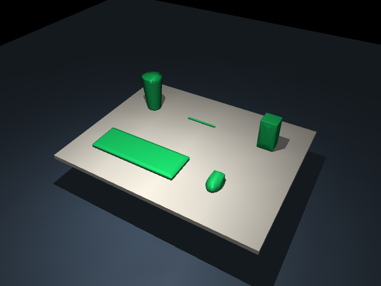

# Desktop objects: keyboard, black shaker, mouse, speaker and pen

These object types were named in user feedback about missing objects. This
fixture uses a **synthetic Blender-rendered reference**, not a new user photo.
Its dimensions, colors and layout are assumptions; it verifies geometry
authoring/export rather than recognition or reconstruction accuracy.

| MuJoCo appearance | Collision hulls |
|---|---|
|  |  |

The keyboard contains a housing and **104 separately modeled keycaps**. The
black shaker has a tapered cup, screw lid, drinking spout and carry loop. The
mouse uses a curved shell plus buttons and a scroll wheel. The speaker has
distinct enclosure, woofer and tweeter geometry. The pen has barrel, writing
tip, rear ring and clip geometry.

No new class was added to a runtime object catalog. The agent-authored
[script](model.py) builds the geometry; the
[object plan](object_plan.yaml) provides free object names and poses. Geometry
with the same base color is batched during export, so the keyboard's 105
editable parts become three visual meshes in MuJoCo. This preserves the
keycaps while avoiding one simulation mesh/geom for every key.

All five objects pass the [2,000-step physics check](scene/desktop_rigid_objects/scene_report.json).
Manual review remains pending. Keys, mouse buttons, wheel and shaker lid are
rigid visual parts, not interactive mechanisms. Convex collision hulls do not
preserve every recess. The default mass is 0.04 kg per rigid body.

[Orbit video](scene/desktop_rigid_objects/scene_preview.mp4) ·
[Annotated reference](scene/desktop_rigid_objects/annotated.png) ·
[Blender preview](scene/desktop_rigid_objects/blender_preview.png) ·
[Editable Blender project](scene/desktop_rigid_objects/project.blend) ·
[Object/part audit](scene/desktop_rigid_objects/export_report.json)

## Reproduce

```powershell
orca-task blender build examples/blender/desktop_objects/object_plan.yaml --script examples/blender/desktop_objects/model.py --output blender_workspaces/my_desktop_objects
# Inspect/edit the opened project and save before export.
orca-task blender export blender_workspaces/my_desktop_objects
orca-task scene generate blender_workspaces/my_desktop_objects/export/scene_spec.yaml --output generated_scenes
orca-task scene check generated_scenes/desktop_rigid_objects
orca-task scene preview generated_scenes/desktop_rigid_objects
```

Run commands at the repository root with the project environment. See the
[workflow tutorial](../../../docs/BLENDER_WORKFLOW.md). Additional new shapes
including scissors and a remote are in [open_objects](../open_objects/README.md);
the [original five-object Blender example](../five_objects/README.md) includes
the soda can. These examples do not restrict the names or shapes of future
objects authored from a user's photo.
