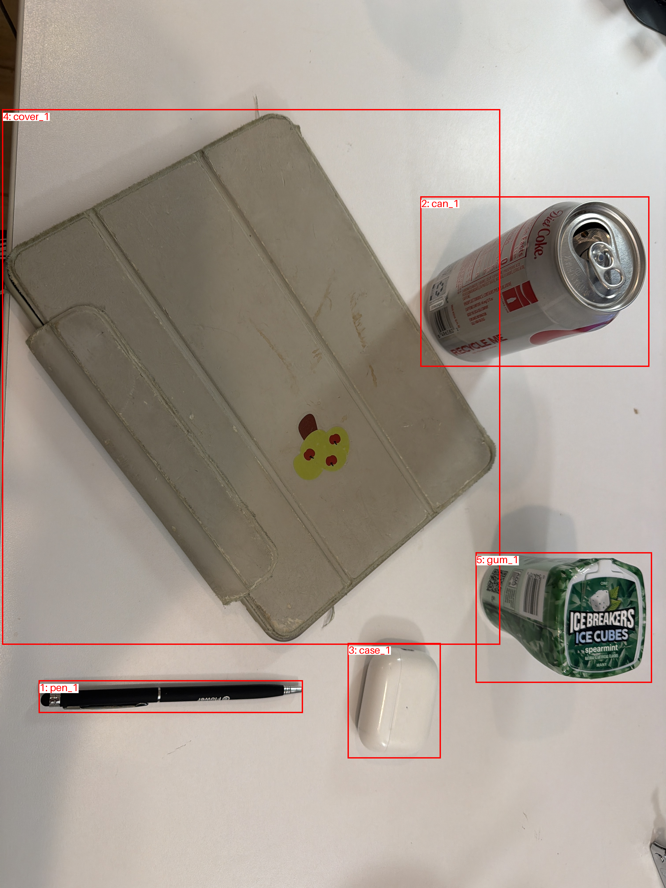
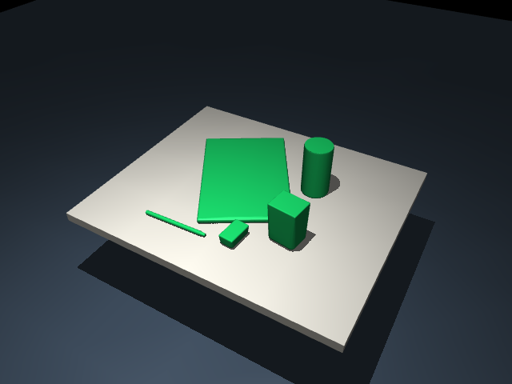

# Five-object photo -> Blender -> MuJoCo

This v0.4 demo extends the [original primitive photo demo](../../photo_generated/scenes/phone_five_objects/README.md)
with editable Blender modeling. It uses the same user-provided phone photograph,
published at the user's request. Source scale assumes a 14 cm pen, and the
previously approved 3 cm downward pen displacement is preserved.

## 1. Source photograph and annotations

| Phone photograph | Object IDs |
|---|---|
|  |  |

The selected objects are `pen_1`, `can_1`, `case_1`, `cover_1` and `gum_1`.
Partially visible border objects are omitted as previously approved.

## 2. Editable Blender models


Compared with the original primitive scene, the model adds rounded charging-case
body/lid geometry, a lid seam, a pen clip and metal parts, a can lid and pull
tab, tablet-cover fold lines, and a gum-container cap/panel. Colors and geometry
are approximate; labels, logos, deformable folds and opening mechanisms are
not reconstructed.

[Object plan](object_plan.yaml) · [Agent-authored modeling script](model.py) ·
[Editable Blender project](scene/blender_five_objects/project.blend)

The project contains a packed source-photo reference, one registered root per
rigid object, editable parts and modifiers, and a centered horizontal tabletop.
The checked-in snapshot was generated headlessly for reproducibility. **Human
Blender review and final MuJoCo visual confirmation remain pending.**

## 3. MuJoCo scene and collision approximation

| Visual meshes | Collision hulls |
|---|---|
|  |  |

Each object has one free rigid body. All visual parts have zero mass and no
collisions; one convex hull provides its physical mass and contact surface.
This mesh example uses the explicit default mass of 0.04 kg per object and
default friction, not values inferred from the photograph.

All five objects pass the [2,000-step physics check](scene/blender_five_objects/scene_report.json).
The pen's final speed remains below the stability threshold. Physics passing
does not establish reconstruction accuracy or record human approval.

[Scene specification](scene/blender_five_objects/scene_spec.yaml) ·
[MuJoCo model](scene/blender_five_objects/scene.xml) ·
[Export report](scene/blender_five_objects/export_report.json)

## 4. Rotating preview

[Watch the five-object MuJoCo orbit video](scene/blender_five_objects/scene_preview.mp4)

The video is a camera orbit after settling the scene, not a grasping attempt
or an RL result. New Blender mesh scenes are display-only in this release.

## Reproduce (background by default)

Install Blender 4.5 LTS and the package as described in the
[Blender workflow tutorial](../../../docs/BLENDER_WORKFLOW.md). From the repository root:

```powershell
orca-task blender build examples/blender/five_objects/object_plan.yaml --script examples/blender/five_objects/model.py --output blender_workspaces/my_five_objects
# Blender saves project.blend in the background; continue directly to export.
orca-task blender export blender_workspaces/my_five_objects
orca-task scene generate blender_workspaces/my_five_objects/export/scene_spec.yaml --output generated_scenes
orca-task scene check generated_scenes/blender_five_objects
orca-task scene preview generated_scenes/blender_five_objects
```

Inspect the checked-in result without installing Blender:

```powershell
orca-task scene view examples/blender/five_objects/scene/blender_five_objects
```

To edit the packaged snapshot, copy its entire scene directory to a local
workspace, then use `orca-task blender open <copied-directory>` and save.
Re-export after editing; direct changes to the packaged `.blend` invalidate
its asset hash until a new scene is generated and reviewed.
