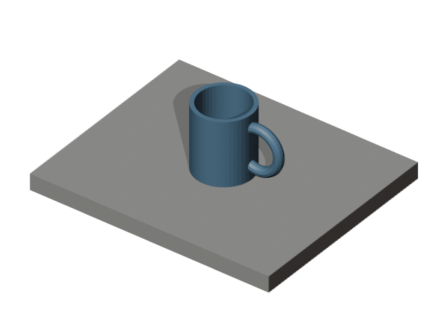
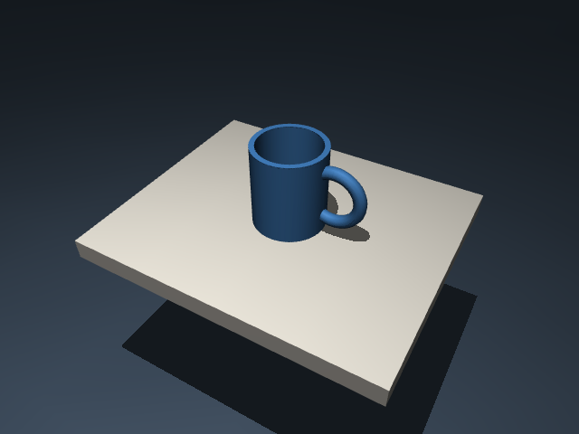
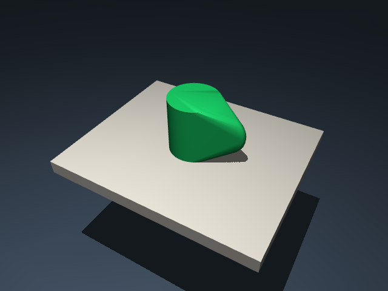

# Synthetic hollow cup and handle

This deliberately **synthetic** example demonstrates a custom rigid shape
outside the six legacy photo categories. `source.png` was rendered locally
in Blender from the included modeling script. It is not a real photograph
and does not demonstrate recognition accuracy.

## Modeling and simulation

| Blender reference | MuJoCo visual model | Collision model |
|---|---|---|
|  |  |  |

The shell is a watertight mesh with an open cup cavity, and the handle is a
separate torus part. Both belong to the `cup_1` rigid root. The exporter combines
their vertices into one convex collision hull. Consequently the visual cup
opening and handle aperture are filled in the collision model. This is useful
for stable scene display, not accurate insertion or handle-interior contact.

The scene passes its [2,000-step stability check](scene/blender_handle_object/scene_report.json).
Manual Blender review and final visual confirmation remain pending. There is
no RL task or learned-policy result.

[Orbit video](scene/blender_handle_object/scene_preview.mp4) ·
[Blender project](scene/blender_handle_object/project.blend) ·
[Object plan](object_plan.yaml) · [Modeling script](model.py) ·
[Export report](scene/blender_handle_object/export_report.json)

## Reproduce

With Blender 4.5 LTS and the package installed, run at the repository root:

```powershell
orca-task blender build examples/blender/handle_object/object_plan.yaml --script examples/blender/handle_object/model.py --output blender_workspaces/my_cup
# Blender saves project.blend in the background; continue directly to export.
orca-task blender export blender_workspaces/my_cup
orca-task scene generate blender_workspaces/my_cup/export/scene_spec.yaml --output generated_scenes
orca-task scene check generated_scenes/blender_handle_object
orca-task scene preview generated_scenes/blender_handle_object
```

See the [Blender workflow tutorial](../../../docs/BLENDER_WORKFLOW.md) for setup,
editable object IDs, transform handling, material support, and failure recovery.
