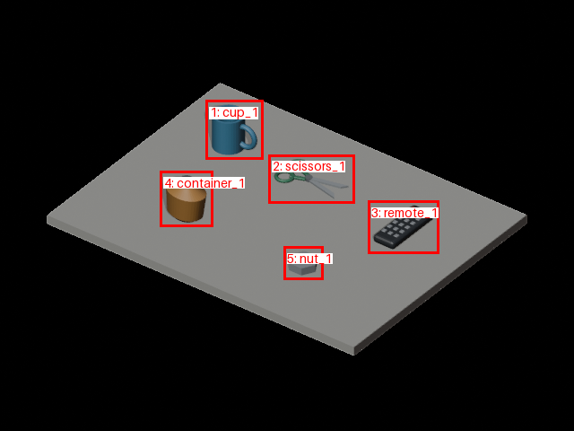
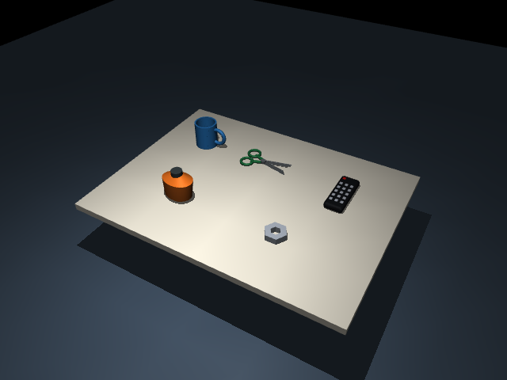

# Open-ended object modeling: cup, scissors, remote, container and nut

This **synthetic Blender reference** verifies that new object types can enter
MuJoCo without a predefined template or a new category registration. It is not
a reconstruction of a real photograph and does not establish vision accuracy.
For a new user photograph the agent writes a new modeling script for the actual
observed geometry; this script is an example, not the supported-object catalog.

| Reference and annotations | MuJoCo visual meshes | Convex collision hulls |
|---|---|---|
|  |  |  |

| Object | Distinctive modeled geometry |
|---|---|
| Cup | Hollow walls, base, and a loop handle |
| Scissors | Two tapered blades, two finger loops, bridges and central pivot |
| Remote | Rounded housing, red power key and fifteen individual keys |
| Irregular container | Asymmetric ring-profile body, narrowed shoulders and cap |
| Hexagonal nut | Six-sided body with a central aperture |

The free-form surfaces use `ctx.add_mesh(id, name, vertices, faces, rgba)`.
The exporter groups visual geometry by base color, preserves the saved mesh
and transform, and generates one collision hull per body. Hollow openings and
finger loops remain visible but may be filled by the hull. Scissors are a
single rigid body in a fixed pose, with no cutting or joint simulation.

All five objects pass the [2,000-step physics check](scene/open_rigid_objects/scene_report.json).
Human Blender review and final visual confirmation are pending; no RL task is
included. Dimensions, mass and friction are authoring assumptions.

[Orbit video](scene/open_rigid_objects/scene_preview.mp4) ·
[Blender preview](scene/open_rigid_objects/blender_preview.png) ·
[Editable project](scene/open_rigid_objects/project.blend) ·
[Exported object/part audit](scene/open_rigid_objects/export_report.json) ·
[MuJoCo manifest](scene/open_rigid_objects/manifest.json)

## Reproduce

With Blender 4.5 LTS installed, run from the repository root:

```powershell
orca-task blender build examples/blender/open_objects/object_plan.yaml --script examples/blender/open_objects/model.py --output blender_workspaces/my_open_objects
# Inspect/edit the opened project and save before export.
orca-task blender export blender_workspaces/my_open_objects
orca-task scene generate blender_workspaces/my_open_objects/export/scene_spec.yaml --output generated_scenes
orca-task scene check generated_scenes/open_rigid_objects
orca-task scene preview generated_scenes/open_rigid_objects
```

See the [workflow guide](../../../docs/BLENDER_WORKFLOW.md) and the additional
[keyboard, shaker, mouse, speaker and pen example](../desktop_objects/README.md).
