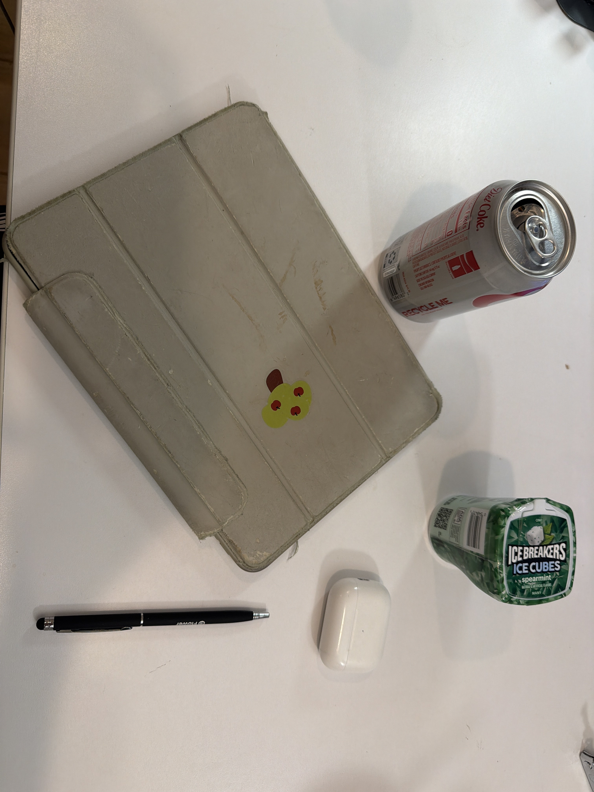
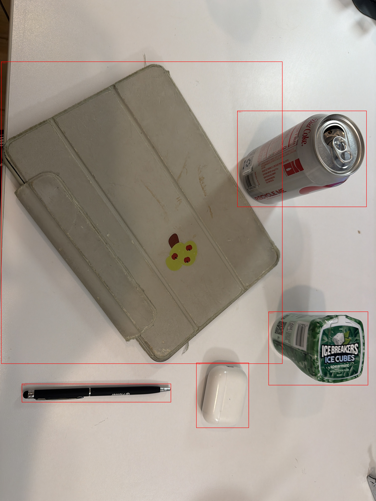
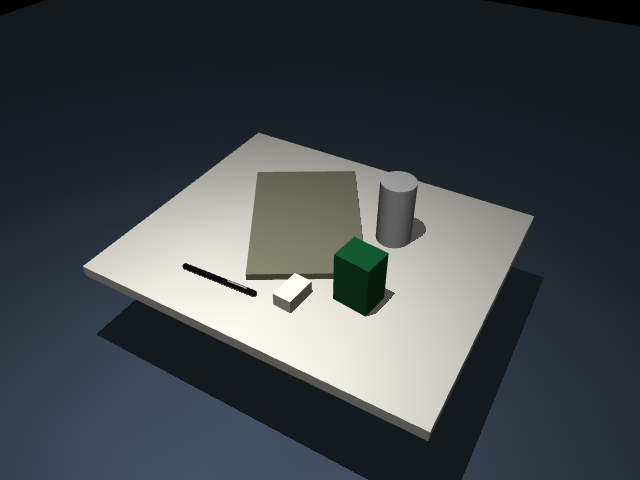

# Five-object phone photo demo

A real phone photograph becomes a five-object MuJoCo tabletop scene through
LAN upload, Codex image interpretation, explicit proxy review, scene generation,
and physics validation. The user provided the photograph and requested its
publication in this repository. This is a scene-only demo, with no ORCA hand
task or training result.

## 1. Source photograph



The five main objects are a black pen, a soda can, a white earbud charging
case, a gray tablet cover, and a green gum container. The user explicitly
chose to omit the partially visible objects at the image borders.
`source.png` is the uploaded photograph normalized to PNG, with orientation
applied and original metadata removed.

## 2. Object annotations



The boxes and IDs were authored from Codex's interpretation of the image.
They are not output from a separate object-detection model in this package.

| Object ID | Photo object | Simulation proxy | Full dimensions (cm) |
|---|---|---|---|
| `pen_1` | Black pen | Thin capsule | 14 x 0.9 x 0.9 |
| `can_1` | Soda can | Upright cylinder | Diameter 6, height 11.5 |
| `case_1` | Earbud charging case | White box | 5.5 x 3.2 x 2.3 |
| `cover_1` | Tablet cover | Flat gray rigid box | 29 x 19 x 1.2 |
| `gum_1` | Gum container | Upright green box | 6 x 5 x 9 |

The pen length is an **assumed** 14 cm catalog default, not a measured
reference supplied by the user. Other dimensions and metric positions are
rough estimates relative to that assumption. Mass and friction are catalog
defaults. The user approved all three box approximations; rounded shells,
logos, fold lines, and opening mechanisms are not reconstructed.

## 3. Generated simulation scene



[Top view](scene_top.png) · [MuJoCo XML](scene.xml) ·
[Scene specification](scene_spec.yaml) · [Manifest](manifest.json)

The first estimated layout placed part of the pen inside the tablet-cover
proxy. The user approved moving the simulated pen **3 cm toward the bottom
of the source photograph** (negative world Y). The final model includes that
adjustment. The annotation remains on the pen's original image location.
Other object placements and dimensions were retained.

The table is a 60 x 50 x 2 cm rigid slab. Its simulated top height is 20 cm;
the real table edges and height are not recovered from this image.

## 4. Rotating preview video

[Watch the rotating MuJoCo scene preview (MP4)](scene_preview.mp4)

The video contains 90 frames at 30 fps: a three-second camera orbit around
the scene after 500 simulation settling steps. It contains no task execution,
grasping attempt, or trained policy.

## Validation and review status

The packaged [physics report](scene_report.json) records a **pass** over
2,000 simulation steps. All five objects remain supported by the tabletop;
maximum recorded penetration is approximately 0.031 mm, and each object's
position drift is below 0.54 mm.

The bundle deliberately retains `confirmed: false` and
`status: needs_confirmation`: the user approved the selected proxies and
the pen correction, but final visual confirmation of this exact generated
scene has not been recorded. Physics validation and visual confirmation are
separate gates. No RL interface or scripted task success is claimed.

## Reproduce from a checkout

Install and activate the environment as described in the
[phone photo tutorial](../../../../docs/PHONE_PHOTO_TUTORIAL.md). From the
repository root:

```powershell
orca-task scene check examples/photo_generated/scenes/phone_five_objects
orca-task scene view examples/photo_generated/scenes/phone_five_objects
```

Regenerate the bundle into a separate local output directory:

```powershell
orca-task scene generate examples/photo_generated/scenes/phone_five_objects/scene_spec.yaml --output generated_scenes/reproduced
orca-task scene check generated_scenes/reproduced/phone_five_objects
orca-task scene preview generated_scenes/reproduced/phone_five_objects
```

Load the packaged scene from Python, run at the repository root:

```python
from orca_sim.taskgen import load_scene

scene = load_scene("examples/photo_generated/scenes/phone_five_objects")
try:
    scene.step(500)
    frame = scene.render()
    print(frame.shape)  # (480, 640, 3)
finally:
    scene.close()
```

The source photograph, relative source path, scene specification, model, and
reports are included so this bundle can be copied and loaded independently
of the original upload session. Capture tokens, session descriptors, local
URLs, and server logs are excluded.
